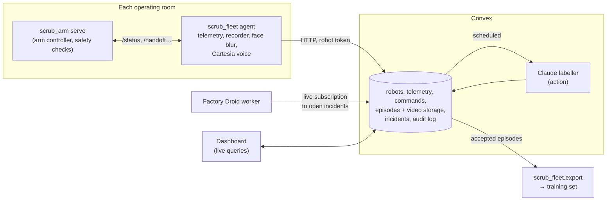

# Scrub fleet: a platform for robotic scrub-tech arms

Each robot arm hands surgical instruments to a surgeon. The fleet platform runs every arm from one place.

**Operations:**
- Every arm reports its live state.
- Operators can send it requests.
- When an arm faults, an agent diagnoses why and proposes a fix, which a person approves.

**Dataset (the stretch goal):** every job an arm does becomes a training episode for world models of surgical manipulation:
- de-identified wrist-camera video,
- a frame-aligned table of what the arm sensed and what it was told to do,
- the spoken request,
- labels written by Claude.



## What each sponsor technology does here

| Technology | Where | What it does in the running product |
|---|---|---|
| **Convex** | `convex/` | The whole backend. It holds the fleet registry and robot auth, the telemetry stream and the command queue. It stores episode video and frames in Convex file storage and runs the incident workflow. A scheduled action does the labelling, and crons prune telemetry and retry failed labels. The dashboard is all live queries: joint angles, Droid's steps and labels update without a refresh. |
| **Claude** (Anthropic) | `convex/labeling.ts` | Labels every consented episode for the dataset. It reads keyframes and the controller's phase timeline and returns structured JSON:<br>• task text, a caption, time segments, success or failure mode,<br>• quality flags,<br>• **privacy flags**,<br>• whether the footage agrees with the robot's own outcome.<br>Disagreements and privacy hits go to a person instead of into the dataset. Runs on `claude-opus-5-5` with structured outputs and server-side refusal fallbacks. |
| **Factory Droid SDK** | `droid/worker.ts` | Triggered by a fault: a live subscription wakes the worker when an arm reports one. Droid reads an evidence bundle: telemetry, arm events, tunable config and the controller source. It returns a diagnosis, a severity, whether a reset is enough, and at most one config change. Every step it takes is streamed to the dashboard. |
| **Cartesia** | `agent/scrub_fleet/speak.py` | The arm's voice in the OR. It confirms every request in call-and-response style ("Castroviejo needle holder, 6-0, Prolene, backhand, coming."). It also says why it stopped, and warns when it can't record. Faults jump the speech queue. |
| **Microsoft** (production agent in healthcare) | Whole design | The agents can't act alone:<br>• robot tokens are stored only as hashes,<br>• operator and worker keys fail closed,<br>• config changes are bounded and allowlisted, and checked on both cloud and robot,<br>• every action lands in an audit log,<br>• privacy blocks enforce consent. |

## Safety and privacy, by design

- **Nothing an agent proposes moves an arm by itself.** Droid runs with autonomy off, and every permission request is auto-rejected. It runs in a throwaway directory, and its process gets no fleet credentials.
  - A proposed change must name one of 8 allowlisted settings and stay inside that setting's bounds (`convex/lib.ts` `TUNABLE`).
  - Convex drops anything else before a person sees it.
  - An operator then approves it.
  - The robot checks it again, edits that one value, keeps a backup, and asks for a restart.
  - Joint limits, gains, poses and motor IDs can't be changed remotely.
- **Remote commands go through the arm's own server.** That server still enforces its own checks: the collision guard, untaught-pose refusal and gripper torque caps. Stop is always available.
- **Video never leaves the robot un-blurred.**
  - Faces are blurred on-device with OpenCV's YuNet detector, whose model is pinned by SHA-256.
  - If the detector can't load, the arm doesn't record and says so out loud.
  - Recording can be paused per arm, for example when a patient declines research use. Episodes recorded without consent are never labelled or exported.
- **Only accepted episodes reach the training set.** An episode is accepted automatically only if it was consented and labelled, and Claude found no privacy or quality flags and agreed with the robot. Everything else waits for a person, and an episode with privacy flags can't be accepted at all.

## Run it

Prerequisites: Node 20+, the `rebot` Python env (see the repo's `CLAUDE.md`).

```bash
cd fleet
npm install
CONVEX_AGENT_MODE=anonymous npx convex dev     # local backend on :3210 (HTTP actions on :3211); or `npx convex dev` for the cloud
npx convex env set OPERATOR_KEY <choose one>    # needed to move arms / approve fixes from the dashboard
npx convex env set WORKER_KEY <choose one>
npx convex env set EXPORT_KEY <choose one>
npx convex env set ANTHROPIC_API_KEY <key>      # episode labelling
npx convex run robots:register '{"name": "OR-3 arm", "site": "Demo bay"}'   # prints the robot token once
npm run dashboard                               # http://localhost:5173
```

On each arm's computer (`source ~/miniforge3/bin/activate rebot`):

```bash
pip install -e fleet/agent
python -m scrub_arm serve                       # or: serve --sim --port 8766 for a simulated arm
CARTESIA_API_KEY=... python -m scrub_fleet.agent \
  --site-url http://127.0.0.1:3211 --token rbt_... --camera <wrist cam index>   # --no-camera --mute for a sim arm
```

To run the Droid worker, install the `droid` CLI (<https://docs.factory.ai>) and set `FACTORY_API_KEY`:

```bash
CONVEX_URL=http://127.0.0.1:3210 WORKER_KEY=... FACTORY_API_KEY=... npm run droid
```

To export the training set:

```bash
python -m scrub_fleet.export --site-url http://127.0.0.1:3211 --key $EXPORT_KEY --out datasets/scrub_v1
```

The output is LeRobot-style:
- `meta/info.json`
- `meta/episodes.jsonl`, with the task text, caption, success and segments
- `data/episode_N.npz`, with `observation_state [T,7]`, `action [T,7]`, `timestamp` and `phase`
- `videos/episode_N.mp4`

`observation_state` and `action` are frame-aligned with the video, which is the input an action-conditioned video world model trains on.

Tests: `npm test` (Convex backend, 16) and `cd agent && python -m pytest` (robot agent, 21).

## What's real and what isn't yet

**Verified on this Mac, with a simulated arm (`scrub_arm serve --sim`):**
- registration,
- heartbeat and telemetry,
- a dashboard-style handoff queued in Convex, run by the agent on the arm, and confirmed out loud,
- a 363-frame episode recorded, face-blurred and uploaded to Convex storage,
- release,
- a fault reported as an incident and claimed by the Droid worker.

**Not run yet:**
- Claude labelling and Droid diagnosis without credentials: both failed cleanly with "no API key".
- Cartesia speech: lines were printed with `--mute`.
- **The real arm with the platform.**

**Known limits:**
- **Simulated arms have no camera**, so their frames are a placeholder. Claude will flag them, and they shouldn't be accepted into the dataset.
- **The dashboard has no user accounts.** The operator key is a shared secret, kept per browser tab, and it's the hackathon stand-in for real staff auth.
- **Config changes take effect on restart.** `scrub_arm` reads `arm.yaml` at startup, so an approved change applies on the next `scrub_arm serve`.
- **Tunable keys can be missing.** `main`'s `arm.yaml` predates the gripper torque settings, so a change to those keys is refused with an explanation until the arm's config has them.
